<p align="center">
  <picture>
    <source media="(prefers-color-scheme: dark)" srcset="docs/logo/logo-dark.svg">
    
  </picture>
</p>

<p align="center">
  <b>Film simulations, real-optics lens effects and an HDR photo editor for Android.</b><br>
  103 looks · HDR light engine · Ultra HDR editing &amp; export · 6 glow styles · 19 lens recipes · edge-aware detail
</p>

<p align="center">
  <a href="https://github.com/amarsakore/lumobo/releases/latest"></a>
  
  
  
  
  
  <a href="LICENSE"></a>
</p>

<p align="center">
  
  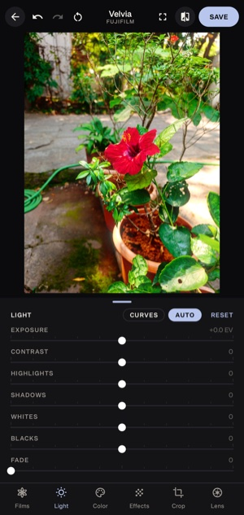
  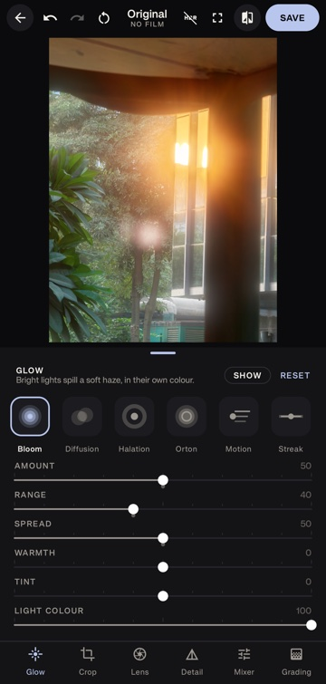
  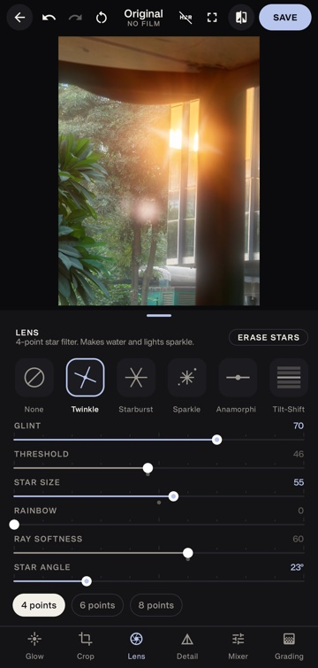
  
</p>

<table>
  <tr>
    <td width="50%"></td>
    <td width="50%"></td>
  </tr>
  <tr>
    <td align="center"><sub><b>Daydream</b> · 1:1 crop · red corner leak · LED date stamp</sub></td>
    <td align="center"><sub><b>Rose Film</b> · Twinkle star filter · straightened 4°</sub></td>
  </tr>
  <tr>
    <td></td>
    <td></td>
  </tr>
  <tr>
    <td align="center"><sub><b>Polaroid 600</b> · instant frame · bloom · vignette</sub></td>
    <td align="center"><sub><b>CineStill 800T</b> · red halation · grain</sub></td>
  </tr>
</table>
<p align="center"><sub>Straight out of the app, developed at full resolution on the phone.</sub></p>

## New in 2.0

- **HDR light engine.** Lumobo reads the HDR gain map that phones such as OnePlus / OPPO (ProXDR), Pixel and Samsung save inside every photo (Ultra HDR, ISO 21496-1), and uses it to know where the real light in the scene is. Stars, streaks, glow, bloom and halation now come from actual light sources, not from anything that happens to be white.
- **Edit and export in HDR.** Photos show in HDR while you edit and in Developed, and save as **Ultra HDR** JPEGs, including the light your effects add. One tap (or a setting) switches the view back to normal brightness.
- **Highlight recovery from HDR.** Pull Exposure or Highlights down and clipped skies, windows and lamps come back with their colour, read from the gain map.
- **Glow**, a new tool: Lightroom's Bloom, Diffusion, Halation, Motion and Streak, plus Orton, with more control than Lightroom.
- **Lens effects rebuilt on real optics.** One star per light source, sized by how much light it gives; power-law rays; true diffraction rainbows; soft focus from spherical aberration; tilt-shift and swirl blur in light.
- **No more halos.** Texture, Clarity, Sharpen and HDR are edge-aware, so even at 100 there's no white glow around buildings, wires or birds.
- **Save as copy**, and effects that no longer blow out when you switch to a brighter film.

## Features

### Looks
- **103 looks in 12 families.** Moody **Vibes** recipes (Daydream, Basement Tape, Summer '99, Night Drive…), **Fujifilm** simulations (Provia, Velvia, Classic Chrome, Classic Neg, Nostalgic Neg, Acros…), **Ricoh GR** image controls, **iPhone**-style filters (Vivid, Dramatic, Mono, Silvertone, Noir…), **Kodak** and **Fuji** film stocks (including infrared Aerochrome), **Agfa**, **Lomography** (LomoChrome Purple, Metropolis), **cinema** stocks and the 2383 print, **instant** film, **Ilford** B&amp;W, and **camera** styles such as disposable, Y2K CCD digicam, Leica M, Hasselblad, Contax T2 and Lomo LC-A.
- **Big, true-to-shape previews.** Every look is previewed on your own photo, in the photo's shape. Picking one shows what it does; tap it again for its **strength**, **frame** and **date stamp**.
- **True to the stock.** Each film is checked against a ColorChecker chart for its contrast, casts, saturation and how it shifts skin, sky and foliage. Slide films build **dye density** (saturated colours get richer and darker, not brighter), and negative films get a gentle **lab scan**: like a minilab, each photo's exposure and colour balance are read first and partly corrected before the film's response.
- **Film character.** Choose how much grain, halation and bloom every film starts with: **Off, Subtle, Natural or Dreamy**. Original always stays clean.
- **My Looks.** Save any mix of film, sliders, effects, glow and lens, then apply it to any photo with one tap.

### Pro editing tools
- **Light:** exposure, contrast, highlights, shadows, whites, blacks and fade, with a one-tap **Auto** and point **Curves** for RGB, red, green and blue. **HDR light** sets how much of the photo's HDR range the edit keeps (0 = a plain SDR photo). Darkening reads the real highlights from the gain map.
- **Color:** temperature, tint, vibrance and saturation; an 8-band **HSL Mixer**; Lightroom-style **Color Grading** wheels for shadows, midtones and highlights.
- **Detail:** texture, clarity, sharpen, dehaze and HDR, all [edge-aware](#edge-aware-detail-no-halos).
- **Glow:** six [glow styles](#glow) with Amount, Range, Spread, Direction, Softness, Warmth, Tint and Light colour, and **SHOW** to see just the light that glows.
- **Effects:** grain (size and colour), halation, bloom, vignette, chromatic aberration and four light-leak styles.
- **Lens:** 19 [lens recipes](#lens-effects) modelled on the real filters and lenses, with Glint, Threshold, Star size, Rainbow, Ray softness and Star angle, and a **star eraser** brush.
- **Crop like Lightroom:** aspect presets (Original, Free, 1:1, 4:5, 3:4, 2:3, 9:16, 16:9, XPan…), straighten dial, vertical and horizontal perspective, flips and 90° rotation. The frame stays put: drag to slide the photo, pinch to zoom it.
- **Frames and imprints:** instant border, white border or 35mm film scan, plus a seven-segment LED date stamp in your colour and format.

### Made to feel good
- **Compact editor.** Every tool sits in one scrolling bar. Panels keep one height, show whole controls only, and slide up smoothly to reveal everything, while the photo shrinks to stay in view.
- **Preview** button to see your photo big, **hold to compare** with the original, and an **HDR** button to view with or without HDR.
- **Undo, redo and Reset all.** A whole slider drag counts as one step; soft haptic ticks on every slider and dial.
- **Develops as you leave.** Going back (or closing the app) with edits develops the photo into **Developed** automatically. Library photos always open fresh.
- **Edit again any time.** Developed photos carry their full recipe, so *Edit Again* picks up exactly where you left off. **Update** saves over the same photo, or **Save as copy** keeps both.
- **Light and dark themes** that follow your phone, and a **Material You** accent that takes your wallpaper's colour.

### Gallery
- Browse by album, with a **date handle** for fast scrolling and Google Photos-style **pinch** to change the grid.
- Open photos from **Google Photos**, or send them to Lumobo from any app with **Edit in Lumobo**.
- **Developed** shows your edits in HDR, with their film name and Edit Again.

### Fast, private and small
- About 20–40&nbsp;ms per preview on a modern phone, and the same GPU pipeline renders the full-resolution export.
- Everything happens on your phone. Nothing is uploaded, and the app is about **3 MB**.

## The HDR light engine

A normal photo stores light up to "white" and throws the rest away: the sun, a lamp and a white wall all end up as the same 255. Modern phones also save an **HDR gain map** inside the JPEG (Ultra HDR, ISO 21496-1; ProXDR on OnePlus / OPPO). It records, per area, how many stops brighter the real scene was. Lumobo reads it and uses it everywhere light matters.

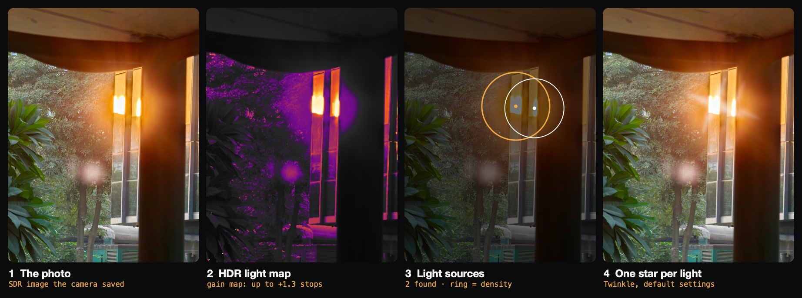

<sub><b>1</b> the SDR photo · <b>2</b> its HDR light map: stops of real light above the scene's own lift (purple a little, orange/white a lot) · <b>3</b> the light sources Lumobo finds; ring size = density (total light) · <b>4</b> Twinkle at default settings: one star from the sun, nothing on the leaves or the white frame.</sub>

### What the engine sees

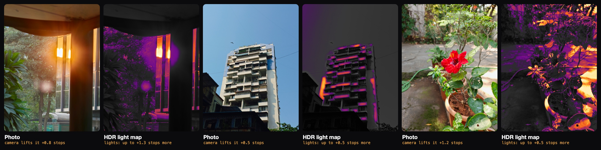

<sub>Cameras lift the whole picture for its HDR version (+0.5 to +1.2 stops here), so Lumobo subtracts the photo's **median** lift and keeps only light that stands above it. Sunlit window glass and petals glow in the map; the blue sky and white paint mostly don't.</sub>

### How it works

1. **Decode with the gain map.** Android's decoder (API 34+) hands over the photo with its `Gainmap`. For each pixel the scene's real light is rebuilt as in the spec:
   `L = mix(log2 ratioMin, log2 ratioMax, G^gamma)` and `HDR = (SDR + ε_sdr) · 2^L − ε_hdr`.
2. **Headroom above the scene.** The photo's median boost is subtracted, so only light standing out from the scene counts:
   `head = max(L − median(L), 0) · smoothstep(0.06, 0.3, Y_sdr)`.
   Photos without a gain map get an estimate: light that clipped *and* stands far above its wide surroundings, `clip · clamp(0.8 · log2((Y + 0.02) / (Y_wide + 0.02)), 0, 3)`.
3. **Light level.** `v = max(Y, 0.85 · max(R, G, B)) · 2^head`. The brightest channel counts, so a red neon sign or golden glints on the sea are lights too, not only white ones.
4. **Light sources.** On a 384-pixel analysis copy, each connected area above the bar is **one** light (a lamp, the sun with its glare, one glint, a light trail). The bar is the higher of "above SDR white" and "above the scene's own brightest surfaces" (its 97th percentile), so white paint, walls and sky never sparkle. For every light it measures:
   - **centre:** where its light is densest (not the first clipped pixel), so the star starts from the middle of the sun;
   - **density:** its total light, which sizes the star (the sun gets a big one, a glint a twinkle);
   - **core size and colour:** ray width and tint;
   - **shape:** from its second moments; long lights (trails, tubes) make fainter stars;
   - **contrast:** it must outshine the median of the area around it, while the frame's main light always qualifies.
5. **Drawing.** Stars and anamorphic flares are drawn once per light (up to 48), see [Lens effects](#lens-effects). Bloom, halation, mist and Glow are fed by the same HDR-weighted light, measured with your exposure and white balance but not the film's lab scan, so switching to a brighter film doesn't blow them out.

### Editing and saving in HDR

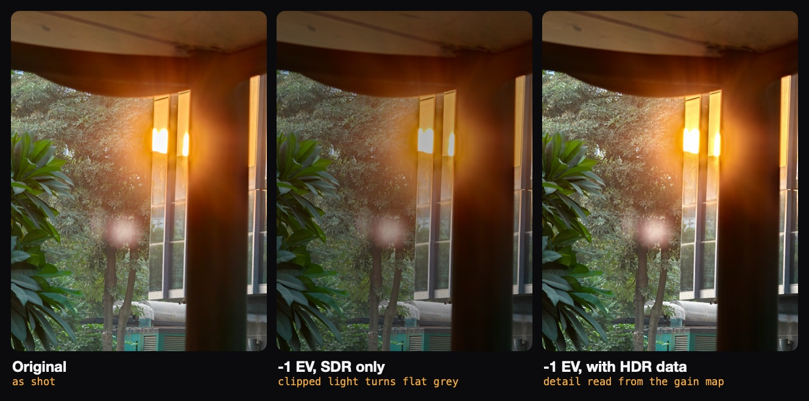

<sub>Exposure −1 EV. With SDR data only, the clipped sun and windows can only turn flat grey. With the gain map Lumobo reads the real light, so they keep their gold and their gradient. Computed from this photo's gain map with the same formula the app uses.</sub>

- **HDR view.** The editor and Developed switch the window to HDR mode (Android 14+). Each preview carries the edited photo's own gain map, which a second GPU pass renders at half resolution:
  `L_out = head_scene · HDR light + log2(1 + 1.5 · added light)`.
  The added light comes from stars, streaks, bloom, mist, halation and Glow, so a star filter's rays really shine above white on an HDR screen.
- **Ultra HDR export.** Saved photos are Ultra HDR JPEGs: an SDR image any app can show, plus a gain map (quarter resolution) that HDR screens use. The edit recipe is kept in EXIF as always.
- **Highlight recovery.** When Exposure, Highlights or Whites come down, the pipeline mixes in the HDR reconstruction (`gmHdr(src) · gain`) before the film's soft shoulder, from the full-resolution gain map when exporting.
- **Your choice.** The HDR button in the editor and viewer, or *Settings → Appearance → Show photos in HDR*, switches the view to normal brightness. The HDR data is still used for light, and edits still save as HDR. **HDR light** in the Light panel sets how much HDR a photo keeps.

## Glow

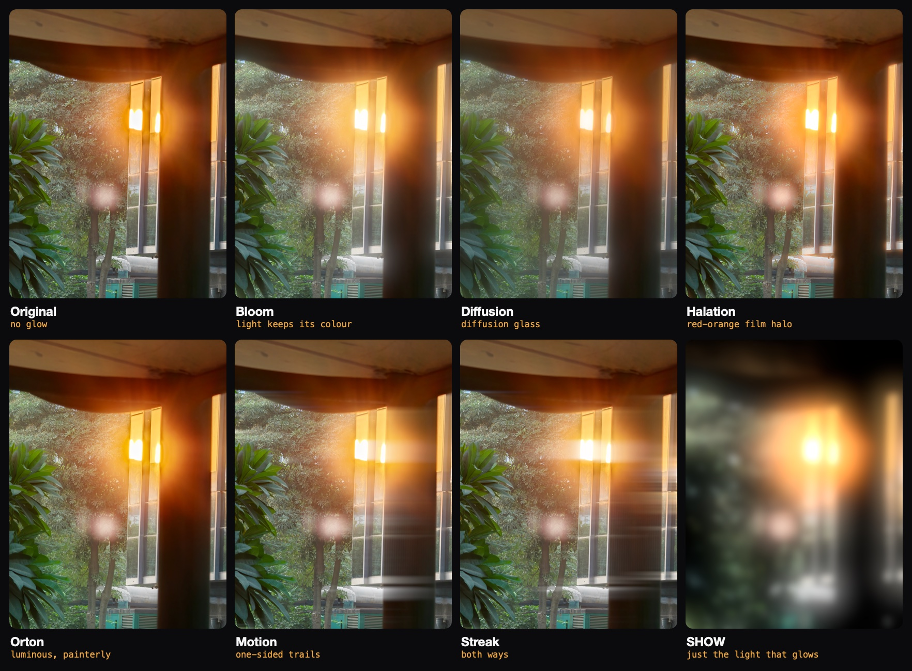

Glow spreads light from the brightest parts of the photo. It has the five styles of Lightroom's Glow (2026), plus Orton and a few things Lightroom can't do:

| Style | How it's made |
|---|---|
| **Bloom** | Haze around lights from a two-scale, long-tailed kernel (tight core + wide skirt), like real scattered light. Each light keeps **its own colour**; Lightroom's Bloom is white only. |
| **Diffusion** | Applied *in front of the film*, like diffusion glass: a share of the light in the chosen tones leaves its place and spreads around it, energy kept. Detail softens, shadows near lights lift, then the film responds. |
| **Halation** | Red-orange halo that hugs each light (the glow minus the light's own core), as light bounces back through film. Its hue is adjustable from yellow to deep red, with tint. |
| **Orton** | The classic Orton glow: the photo screened with itself, multiplied by a brightened, softened copy. Luminous, painterly, rich colour. |
| **Motion** | Light trails off one side of each light, as from a moving camera. |
| **Streak** | Anamorphic-style streaks through point lights, both ways. Broad bright areas streak only faintly. |

**Sliders:** Amount · **Range** (how far down the tones the glow reaches) · **Spread** (Length for Motion/Streak) · **Direction** and **Softness** (Motion/Streak) · **Warmth** (Colour for Halation) · **Tint** · **Light colour** (white light ↔ each light's own colour). **SHOW** previews just the light that glows, so you can set Range and Spread precisely. The light comes from the [HDR light engine](#the-hdr-light-engine), so real lights glow more than white surfaces.

## Lens effects

Every recipe is modelled on what the real filter or lens does to light.

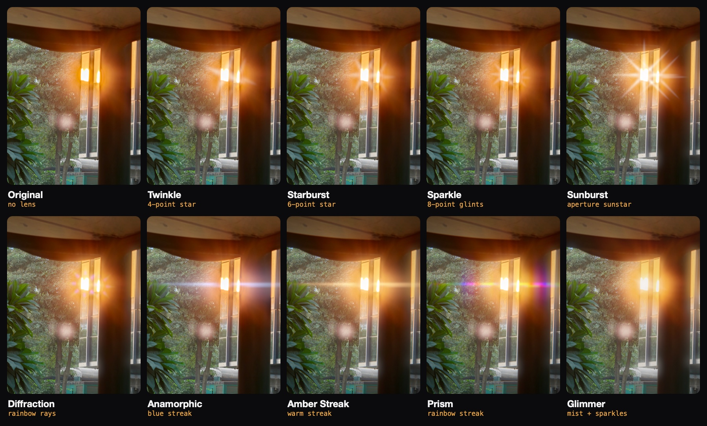

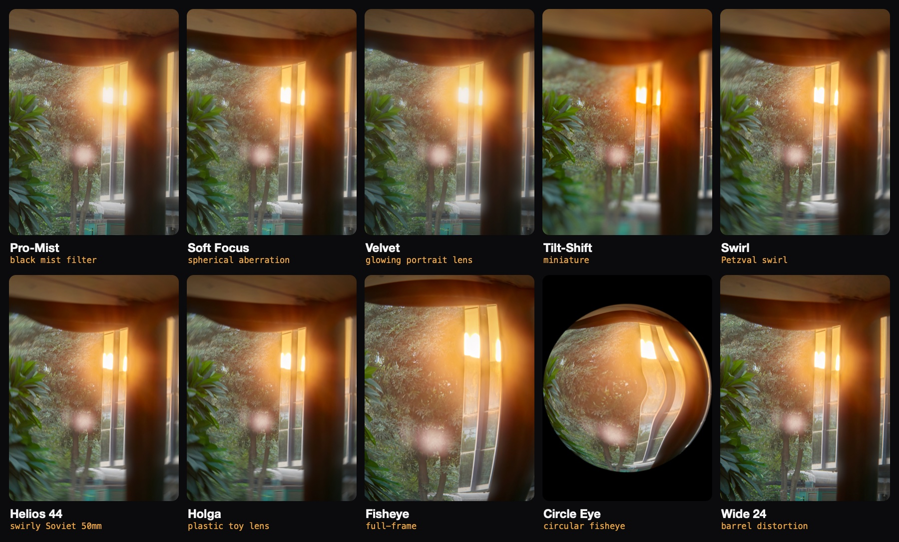

| Recipe | The real thing | How Lumobo renders it |
|---|---|---|
| **Twinkle · Starburst · Sparkle** | Cross-screen star filters: a fine grating diffracts a small share of *all* light into spikes, visible only from light far brighter than the scene. | One star per detected light source: brightness from how far it outshines white, length from its density, rays with a power-law falloff `1/(1 + (k·t)²)` that start at the light's edge, as wide as its core (soft) or a fine tapering line (crisp). Red reaches ~6% further than blue, as diffraction scales with wavelength. |
| **Sunburst** | An aperture "sunstar": each blade edge diffracts a thin, sharp ray. | Thin, long, crisp rays (Ray softness low). |
| **Diffraction** | A grating that spreads light into spectra. | Each ray carries repeating diffraction orders, blue nearest the light through green and yellow to red, blended smoothly and fading outward. |
| **Anamorphic · Amber Streak** | A cylindrical element stretches flare into a horizontal line; coatings set its colour. | A thin bright line through each light inside a broad soft band of the same colour; cool blue to warm amber. |
| **Prism** | A prism filter splitting light into a rainbow streak. | The anamorphic streak spread into smoothly blended spectra. |
| **Pro-Mist · Glimmer** | Black Pro-Mist: particles scatter a share of each light into a wide halo; black specks keep shadows deep. | Energy moves from highlights into a soft halo (the light itself eases), with only a faint veil, so blacks stay deep. Glimmer adds fine sparkles. |
| **Soft Focus · Velvet** | Under-corrected spherical aberration lays a glowing, out-of-focus image over a sharp one. | A halo layer mixed **in light** over the sharp image, so highlights bloom and detail stays underneath. |
| **Tilt-Shift** | A tilted plane of focus: blur grows steadily with distance from the sharp band. | Disc (bokeh) blur whose radius grows with distance from the band, averaged in light so bright points spread into soft discs. |
| **Swirl · Helios 44 · Holga** | Cat's-eye vignetting and off-axis aberrations smear the image along circles round the centre. | Light gathered along the circle through each point, growing toward the corners; Helios adds colour fringing and vignette, Holga a soft toy-lens edge. |
| **Fisheye · Circle Eye · Wide 24** | Fisheye and wide-angle projections. | A true tangent projection; the circular version maps the whole frame into the circle. |

Stars and streaks have **Glint**, **Threshold** (which lights qualify), **Star size**, **Rainbow**, **Ray softness** and **Star angle**, plus a **star eraser** brush to paint out lights you don't want to sparkle.

## Edge-aware detail (no halos)

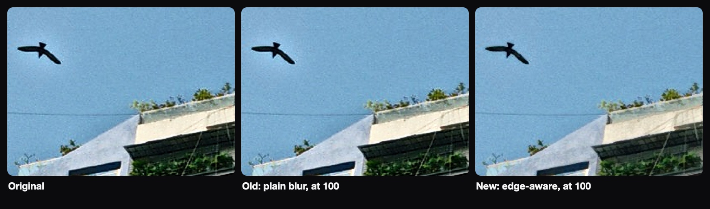

<sub>Texture, Clarity and Sharpen at 100 on the same crop. A plain blur mixes the sky into the bird and roofline, so they get a white glow; the edge-aware version keeps them clean. (CPU model of the old and new detail shaders.)</sub>

- **Clarity** compares each pixel with a **bilateral** (edge-stopping) local mean of a tone guide: neighbours much brighter or darker than the pixel are left out, so the mean stays on its own side of an edge.
- **Texture** uses the same idea on the mip chain, at a finer scale.
- **Sharpen** finds edges with a **Sobel** filter, sharpens texture and medium edges, leaves flat sky and skin alone (no noise boost), and clamps the result to the 3×3 neighbourhood's own darkest and brightest values, so it can never overshoot into a halo.
- **HDR** (the detail slider) uses a separable **joint bilateral** wide tone with edge-aware upsampling, so skies and skylines don't get a bright band.
- Detail tones are measured before Dehaze, so Dehaze no longer shifts them.

## Before / after

<table>
  <tr>
    <td></td>
    <td></td>
    <td>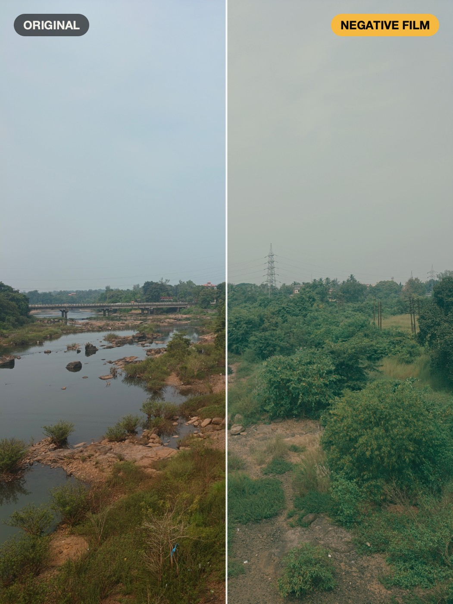</td>
  </tr>
  <tr>
    <td align="center"><sub>Classic Chrome</sub></td>
    <td align="center"><sub>Velvia</sub></td>
    <td align="center"><sub>GR Negative Film</sub></td>
  </tr>
</table>

## The app

<p align="center">
  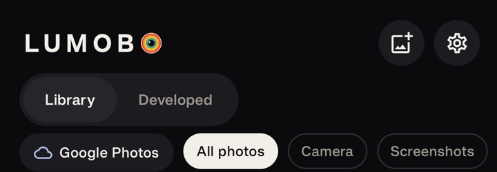
</p>

<p align="center">
  
  
  
  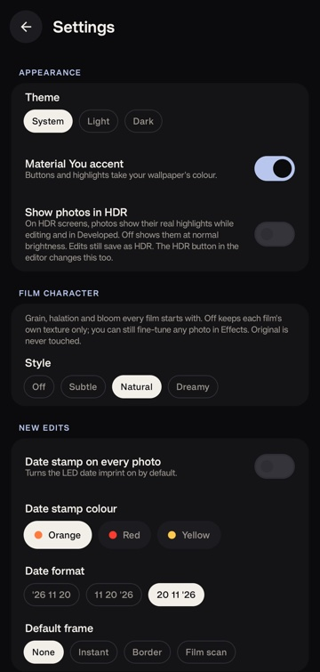
</p>

## Install

Download `Lumobo.apk` from the [latest release](https://github.com/amarsakore/lumobo/releases/latest) and open it on your phone (allow installs from your browser or file manager when asked). Requires Android 10 or newer with OpenGL ES 3.0; HDR viewing and Ultra HDR export need Android 14 or newer.

Lumobo collects nothing and has no internet access: see the [privacy policy](PRIVACY.md).

Or with a phone connected over USB debugging:

```bash
adb install -r Lumobo.apk
```

## The look library

The grids below show colour only, so you can compare the looks directly. Grain, halation, lens effects and frames are added on top in the app.

### Vibes: moody analog recipes

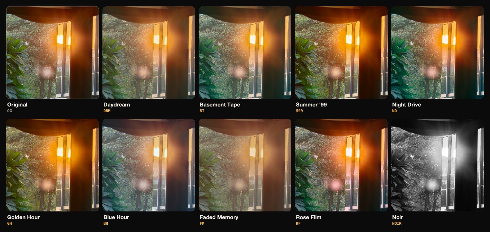

| Look | Code | Character |
|---|---|---|
| **Daydream** | `DRM` | Soft pastel warmth, glowing highlights and a stray red leak. |
| **Basement Tape** | `BT` | Late-night snapshot. Teal shadows, amber glow, heavy corners. |
| **Summer '99** | `S99` | Point-and-shoot holiday prints. Sunny, saturated, date-stamped. |
| **Night Drive** | `ND` | Neon-soaked and cinematic. Cyan night, glowing red halos. |
| **Golden Hour** | `GH` | Late sun forever. Honeyed highlights and a warm haze. |
| **Blue Hour** | `BH` | Cool, quiet and a little melancholic. |
| **Faded Memory** | `FM` | A print left in the sun. Washed, creamy and nostalgic. |
| **Rose Film** | `RF` | Experimental stock with rosy highlights and cool shadows. |
| **Noir** | `NOIR` | Hard-boiled black & white with glowing highlights. |

### Fujifilm film simulations

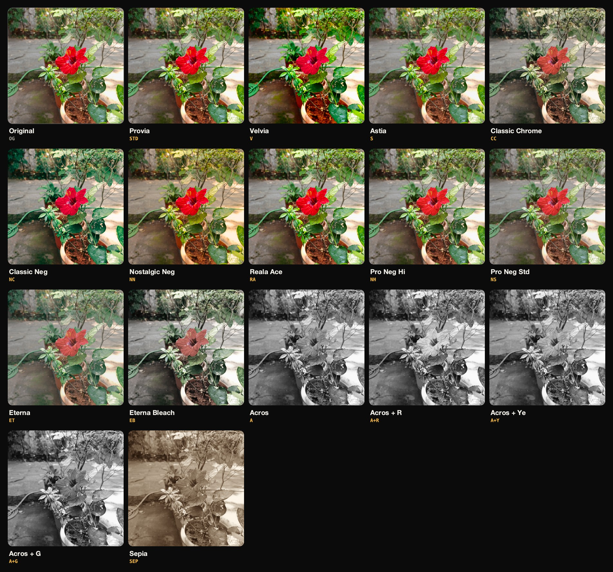

| Look | Code | Character |
|---|---|---|
| **Provia** | `STD` | Standard. Faithful colour with a gentle slide-film punch. |
| **Velvia** | `V` | Vivid. Saturated landscape slide film with deep blacks and rich skies. |
| **Astia** | `S` | Soft. Gentle tonality for skin, while keeping skies vivid. |
| **Classic Chrome** | `CC` | Documentary slide look. Muted colour, hard shadows, deep teal skies. |
| **Classic Neg** | `NC` | Superia-inspired. Hard contrast, teal shadows, warm highlights, magenta reds. |
| **Nostalgic Neg** | `NN` | 70s American colour. Amber highlights, soft roll-off, rich shadows. |
| **Reala Ace** | `RA` | Faithful colour with a crisp, hard tonality. |
| **Pro Neg Hi** | `NH` | Portrait negative with a little extra contrast. |
| **Pro Neg Std** | `NS` | Soft studio negative. Low contrast, natural, flattering skin. |
| **Eterna** | `ET` | Motion-picture stock. Flat, low saturation, teal shadows. |
| **Eterna Bleach** | `EB` | Skipped-bleach cinema process. Silver-retained, harsh and desaturated. |
| **Acros** | `A` | Fine-grain black & white with rich, deep tonality. |
| **Acros + R** | `A+R` | Acros through a red filter. Dark dramatic skies, bright skin. |
| **Acros + Ye** | `A+Y` | Acros through a yellow filter. Gently deepened skies. |
| **Acros + G** | `A+G` | Acros through a green filter. Smooth skin, lighter foliage. |
| **Sepia** | `SEP` | Warm brown-toned monochrome. |
| **Monochrome** | `FMO` | Fujifilm's standard black & white. Neutral, faithful grey tones. |

### Ricoh GR image controls


| Look | Code | Character |
|---|---|---|
| **GR Standard** | `STD` | The GR's clean, crisp default rendering. |
| **Positive Film** | `PF` | Slide film punch. Warm, saturated, contrasty with yellow-tinted highlights. |
| **Negative Film** | `NF` | Low-contrast print look. Faded cyan blacks, muted colour. |
| **Hi-Contrast B&W** | `HC` | The GR street classic. Gritty, crushed and graphic. |
| **Bleach Bypass** | `BB` | Desaturated, metallic and contrasty. |
| **Retro** | `RT` | Faded and warm, like an old print in a shoebox. |
| **Cross Process** | `XP` | Slide film in negative chemistry. Yellow-green highs, blue shadows. |
| **Hi-Key** | `HK` | Bright, airy and soft. |

### iPhone-style filters

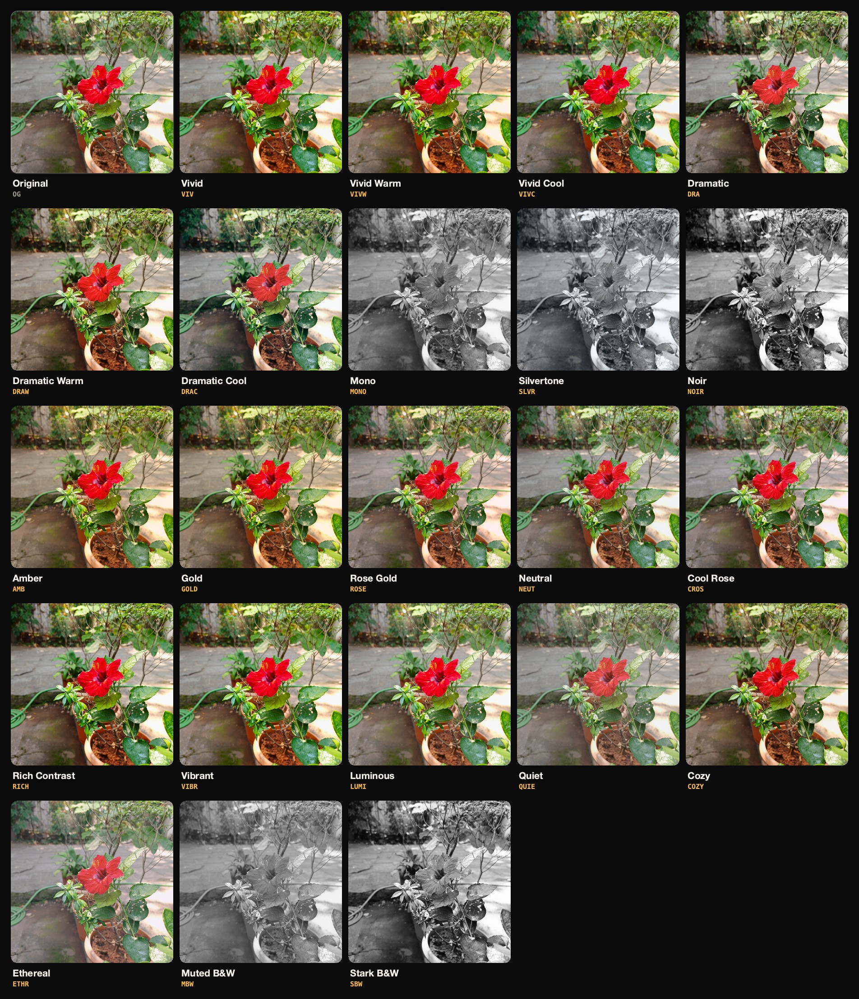

| Look | Code | Character |
|---|---|---|
| **Vivid** | `VIV` | iPhone Photos filter. Punchy, saturated, bright colour. |
| **Vivid Warm** | `VIVW` | Vivid with a warm, golden lift. |
| **Vivid Cool** | `VIVC` | Vivid with crisp, cool blues. |
| **Dramatic** | `DRA` | Deep contrast with restrained colour. |
| **Dramatic Warm** | `DRAW` | Dramatic, with warm amber shadows and light. |
| **Dramatic Cool** | `DRAC` | Dramatic, steely blue and moody. |
| **Mono** | `MONO` | Clean, even black & white. |
| **Silvertone** | `SLVR` | Bright, silvery B&W with a cool sheen. |
| **Noir** | `NOIR` | High-contrast B&W with inky shadows. |
| **Amber** | `AMB` | Photographic Style. A soft amber glow over skin and light. |
| **Gold** | `GOLD` | Photographic Style. Rich golden warmth. |
| **Rose Gold** | `ROSE` | Photographic Style. Warm with a gentle rose blush. |
| **Neutral** | `NEUT` | Photographic Style. Neutralises warmth for true-to-life tones. |
| **Cool Rose** | `CROS` | Photographic Style. Cool light with a hint of pink. |
| **Rich Contrast** | `RICH` | Photographic Style. Deeper shadows, richer colour. |
| **Vibrant** | `VIBR` | Photographic Style. Bright, lively colour. |
| **Luminous** | `LUMI` | Photographic Style. Bright and airy with open shadows. |
| **Quiet** | `QUIE` | Photographic Style. Soft, faded, muted calm. |
| **Cozy** | `COZY` | Photographic Style. Warm, dim and intimate. |
| **Ethereal** | `ETHR` | Photographic Style. Dreamy pastel softness. |
| **Muted B&W** | `MBW` | Photographic Style. Gentle, low-contrast monochrome. |
| **Stark B&W** | `SBW` | Photographic Style. Bold, graphic monochrome. |

### Kodak


| Look | Code | Character |
|---|---|---|
| **Portra 400** | `P400` | The portrait standard. Warm skin, soft contrast, pastel greens. |
| **Portra 160** | `P160` | Finer and cooler than 400. Clean pastel daylight. |
| **Portra 800** | `P800` | Pushed portrait stock. Warmer, richer and grainier. |
| **Ektar 100** | `E100` | The world's finest-grain colour negative. Ultra-saturated and punchy. |
| **Gold 200** | `G200` | Golden-hour in a box. Warm yellows and nostalgic sunshine. |
| **ColorPlus 200** | `CP` | Budget everyday film. Warm, slightly soft, honest. |
| **UltraMax 400** | `UM` | Consumer all-rounder. Saturated reds and warm daylight. |
| **Kodachrome 64** | `KR` | The legendary slide film. Deep reds, dense blacks, timeless warmth. |
| **Ektachrome E100** | `E6` | Modern slide film. Clean, cool and vivid blues. |
| **Tri-X 400** | `TX` | The photojournalist's B&W. Punchy contrast, honest grain. |
| **T-Max 100** | `TMX` | Tabular-grain B&W. Smooth, sharp and modern. |
| **Pro Image 100** | `PI` | Warm portrait stock made for hot climates. Gentle contrast, golden skin. |
| **Aerochrome** | `AERO` | Infrared false colour. Leaves turn crimson and pink, skies go deep blue. |

### Fuji film stocks

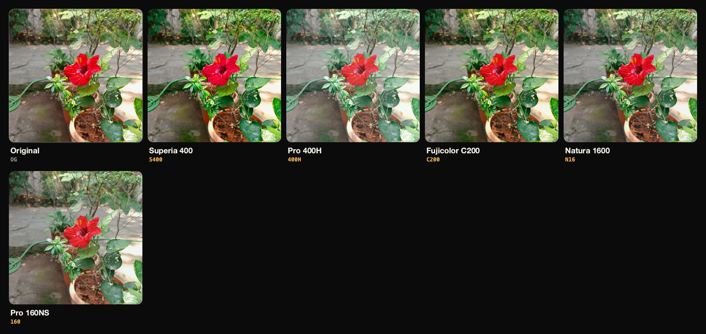

| Look | Code | Character |
|---|---|---|
| **Superia 400** | `S400` | Fuji's consumer classic. Cool greens and that tell-tale cyan shadow. |
| **Pro 400H** | `400H` | Wedding-photographer favourite. Airy, minty greens, soft pastel skin. |
| **Fujicolor C200** | `C200` | Cheap and cheerful. Slightly green, a little grainy, very lovable. |
| **Natura 1600** | `N16` | Low-light legend. Cool, clean shadows and natural skin under any light. |
| **Pro 160NS** | `160` | Soft studio negative. Natural skin, gentle greens, airy highlights. |

### Agfa

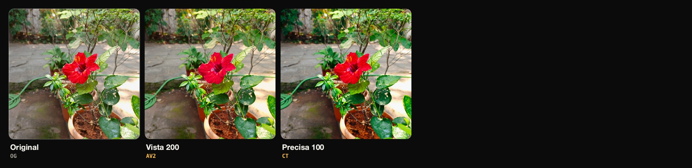

| Look | Code | Character |
|---|---|---|
| **Vista 200** | `AV2` | Agfa's cheerful negative. Punchy reds, warm yellows, cyan-leaning skies. |
| **Precisa 100** | `CT` | Agfa slide film. Cool, crisp and saturated with bright blues. |

### Cinema


| Look | Code | Character |
|---|---|---|
| **CineStill 800T** | `800T` | Tungsten cine film without remjet. Cool cast and glowing red halation. |
| **CineStill 50D** | `50D` | Daylight cine stock. Clean, crisp and saturated with a soft glow. |
| **Vision3 250D** | `250D` | Hollywood daylight negative. Wide latitude, natural skin, gentle teal. |
| **Vision3 500T** | `500T` | Night-time cine negative. Cool shadows, warm practical lights. |
| **Blockbuster** | `T&O` | Teal and orange colour grade. Big, warm skin against cool shadows. |
| **2383 Print** | `2383` | Kodak print film. Rich blacks, teal shadows, warm skin: the classic cinema finish. |
| **Vision3 50D** | `V50` | Kodak's finest daylight motion-picture stock. Clean, wide latitude, natural colour. |

### Instant


| Look | Code | Character |
|---|---|---|
| **Polaroid 600** | `600` | Instant integral film. Creamy whites, inky blue-black, dreamy colour. |
| **SX-70** | `SX` | Vintage instant. Warm, washed-out and soft-focus. |
| **Instax Mini** | `MINI` | Bright, poppy party instant with cool shadows. |
| **Expired Polaroid** | `EXP` | Out-of-date instant film. Faded magenta and teal shifts, creamy lifted blacks. |

### Camera styles

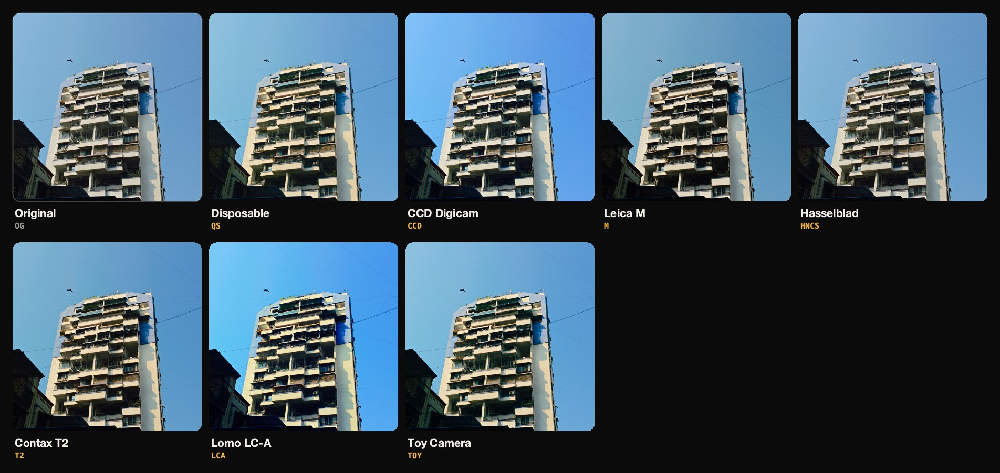

| Look | Code | Character |
|---|---|---|
| **Disposable** | `QS` | Single-use flash camera. Warm, grainy, vignetted, date-stamped. |
| **CCD Digicam** | `CCD` | Y2K compact digital. Cool, punchy, bright highlights with a CCD glow. |
| **Leica M** | `M` | Rangefinder rendering. Dense blacks, warm mids, restrained greens. |
| **Hasselblad** | `HNCS` | Natural colour solution. Smooth gradation and true-to-life skin. |
| **Contax T2** | `T2` | Premium point-and-shoot on colour neg. Warm, sharp, contrasty. |
| **Lomo LC-A** | `LCA` | Shoot from the hip. Saturated, contrasty, heavy vignette. |
| **Toy Camera** | `TOY` | Plastic lens, leaky body. Dreamy glow, soft corners, light leaks. |

### Lomography

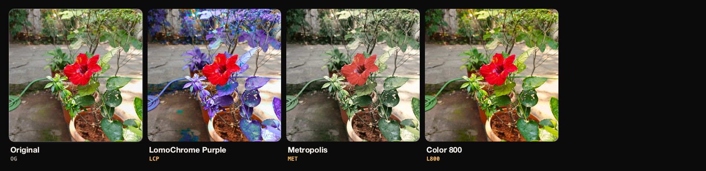

| Look | Code | Character |
|---|---|---|
| **LomoChrome Purple** | `LCP` | Greens turn purple, blues turn teal, skin stays warm. |
| **Metropolis** | `MET` | Desaturated urban film. Muted colour, punchy contrast, greenish shadows. |
| **Color 800** | `L800` | Lomography's fast colour negative. Warm, punchy, saturated and grainy. |

### Ilford black & white


| Look | Code | Character |
|---|---|---|
| **HP5 Plus 400** | `HP5` | Versatile, forgiving B&W with classic medium grain. |
| **FP4 Plus 125** | `FP4` | Fine-grain, medium-contrast B&W with lovely mid-tones. |
| **Pan F Plus 50** | `PANF` | Slow, razor-fine B&W. Deep blacks and luminous highlights. |
| **Delta 3200** | `D32` | Ultra-fast B&W. Bold, gritty grain for low light. |
| **XP2 Super** | `XP2` | Chromogenic B&W. Smooth tones, almost no grain, gentle contrast. |
| **SFX 200** | `SFX` | Extended-red B&W. Dark skies, glowing foliage and skin, a near-infrared feel. |

## How it works

Each look is a small, readable recipe in [`Profiles.kt`](film/src/main/kotlin/app/lumobo/film/Profiles.kt) evaluated by a film model in [`Look.kt`](film/src/main/kotlin/app/lumobo/film/Look.kt):

1. **Exposure and white balance** in linear light, with a soft film shoulder instead of hard clipping.
2. **Tone curve**: a display-referred S-curve that blends a per-channel response (film's saturation and colour crossover) with a luminance-preserving one (stable hues).
3. **Colour** in OKLCh: global and tone-dependent saturation, plus hue bands that shift, saturate or darken specific colours.
4. **Colour casts** in shadows, mids and highlights, mostly on near-neutral tones so saturated subjects keep their identity.
5. **Gamut mapping** that reduces chroma at constant lightness and hue, then **print levels** for faded blacks or creamy whites.

The model is baked into a **64³ 3D LUT**. An OpenGL ES 3 pipeline ([`GlRenderer.kt`](app/src/main/java/app/lumobo/render/GlRenderer.kt), [`Shaders.kt`](app/src/main/java/app/lumobo/render/Shaders.kt)) applies it with the user adjustments, crop and straighten, lens projection and the optical passes:

- **Light analysis** ([`LightPoints.kt`](app/src/main/java/app/lumobo/render/LightPoints.kt)): the photo and its gain map are analysed once into a light map and a list of light sources.
- **Working-resolution passes** (640 px): tone guide and joint-bilateral passes for the edge-aware detail tools, halation, bloom, mist and the Glow light at two scales, all at a fixed resolution so the preview and the export glow identically.
- **Stars and streaks** are drawn per light source in one pass.
- **Main pass**: detail, the film LUT, light and colour tools, curves, grading, lens blur, glow and optics in linear light, grain, vignette and leaks.
- **Gain-map pass**: the edited photo's own HDR gain map, attached to the preview and the export.
- **Grain** comes from a tileable, gaussian-clumped noise field sized to the frame.

Every developed JPEG carries its edit recipe in EXIF, which is what makes *Edit Again* non-destructive.

Here is a complete look:

```kotlin
FilmProfile(
    "vibe_daydream", "Daydream", "DRM", Category.VIBES,
    "Soft pastel warmth, glowing highlights and a stray red leak.",
    Look(
        temp = 0.06f,
        curve = Curve(contrast = 0.92f, shadows = 0.10f, highlights = -0.12f, whites = -0.15f),
        rgbCurveMix = 0.5f, saturation = 0.96f,
        bands = listOf(
            Band(Hue.SKIN, 30f, shift = 2f, sat = 0.98f, light = 0.02f),
            Band(Hue.FOLIAGE, 40f, shift = -4f, sat = 0.85f),
            Band(Hue.SKY, 50f, shift = -6f, sat = 0.92f),
        ),
        shadowTone = Tone(205f, 0.016f), highlightTone = Tone(70f, 0.030f),
        black = Rgb(0.045f, 0.04f, 0.04f), white = Rgb(1f, 0.98f, 0.95f),
    ),
    Effects(grain = 0.24f, grainSize = 0.4f, halation = 0.18f, bloom = 0.38f, leak = 0.42f, leakStyle = 1, dateStamp = true),
),
```

## Build from source

Requirements: JDK 17 and the Android SDK (platform 35).

```bash
./gradlew :app:assembleRelease     # app/build/outputs/apk/release/app-release.apk
./gradlew :film:test               # colour-engine tests
```

The colour engine is a plain Kotlin/JVM module, so you can tune looks on your computer:

```bash
# Render every look onto your own photos, 6 per sheet
./gradlew :film:test --tests '*ContactSheetTest*' \
  -Dcontact.in=/path/to/photos -Dcontact.out=/tmp/sheets -Dcontact.chunk=6

# Measure every look on a ColorChecker chart (contrast, casts, saturation, density, hue shifts)
./gradlew :film:test --tests '*FilmTraitsTest*' -i

# Regenerate the README example images
./gradlew :film:test --tests '*ReadmeAssetsTest*' \
  -Dassets.in=/path/to/sources -Dassets.out=$PWD/docs/examples
```

## Project structure

```
film/                      Pure Kotlin colour science (no Android dependencies)
  ColorMath.kt             sRGB transfer, OKLab/OKLCh, fast lookup tables
  Look.kt                  Curve, Look and CompiledLook (film model and LUT baking)
  Profiles.kt              Every look, lens recipes, film-texture flavours, geometry
  Adjustments.kt           User adjustments, LUT cache, grain field generator
app/
  render/GlRenderer.kt     EGL off-screen renderer: LUT, gain maps, glow / star / blur passes, export
  render/Shaders.kt        GLSL: film pipeline, edge-aware detail, lens, glow, optics, HDR, grain
  render/LightPoints.kt    HDR light map and light-source detection
  render/Overlays.kt       LED date stamp and frames
  render/Images.kt         Decoding (EXIF-aware, sRGB) and saving with recipe + metadata
  editor/                  Editor state, undo/redo, recipes, re-edit resolution
  data/                    Settings, My Looks, gallery thumbnails
  ui/                      Compose screens: gallery, editor (incl. Glow panel), viewer, settings
docs/                      Logo, examples, screenshots
```

## Disclaimer

Fujifilm, Provia, Velvia, Astia, Acros, Eterna, Superia, Ricoh, GR, Kodak, Portra, Ektar, Kodachrome, Ektachrome, Tri-X, T-Max, CineStill, Polaroid, Instax, Ilford, Leica, Hasselblad, Contax, Lomo, Lomography, LomoChrome, Agfa, Apple and iPhone are trademarks of their respective owners. Lumobo is an independent project and is not affiliated with or endorsed by any of them. The looks are original recreations of each film's or camera's well-known character. They contain no proprietary data.

## License

[MIT](LICENSE) © 2026 amarsakore
