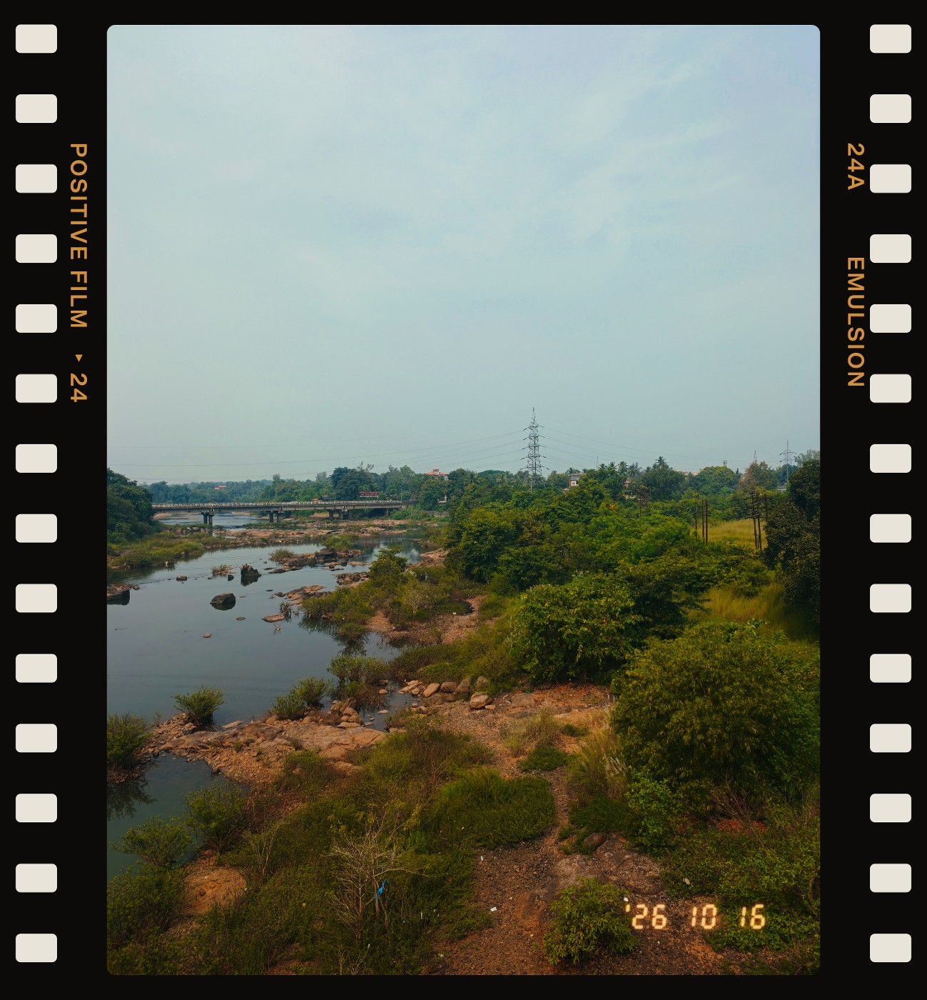
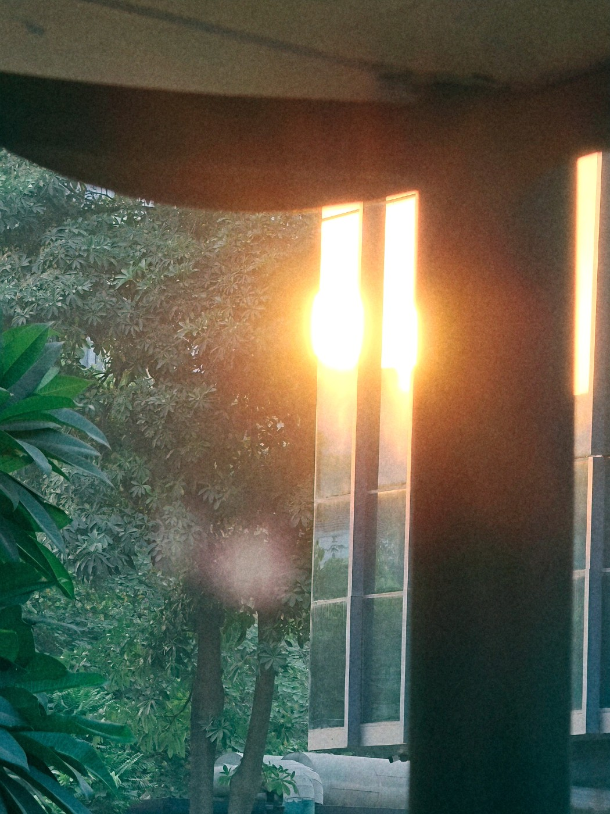
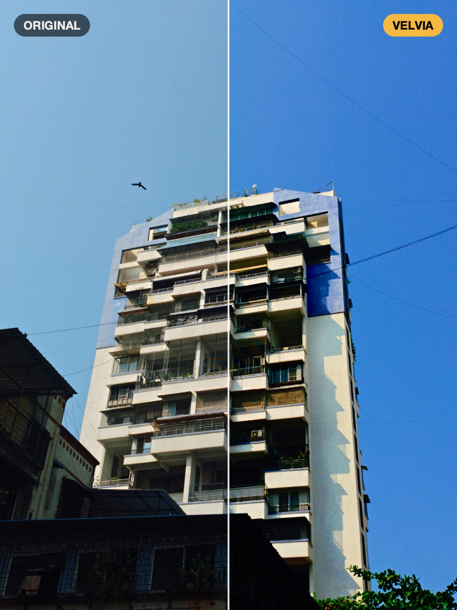
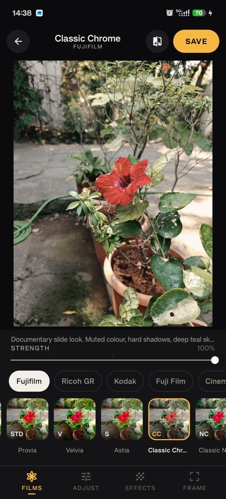
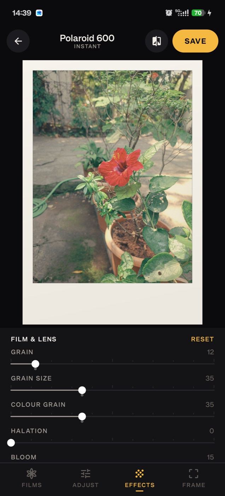
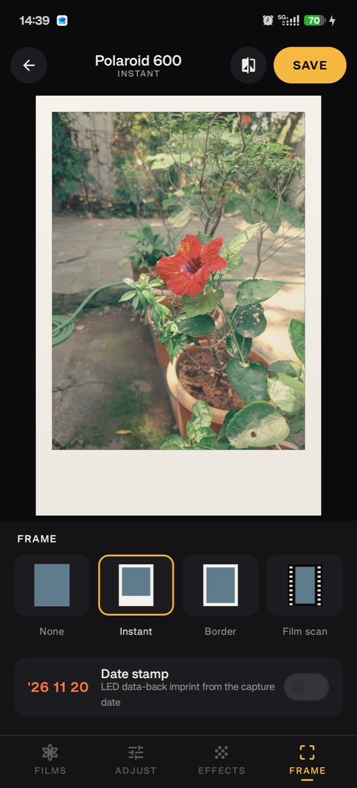
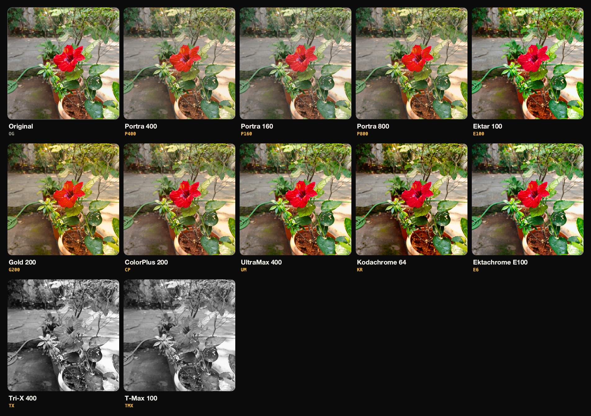
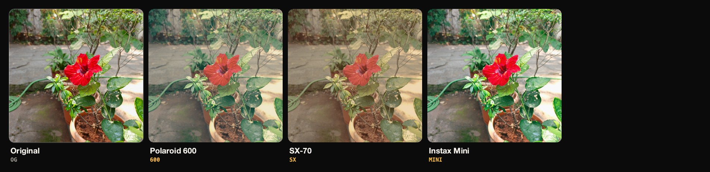

<p align="center">
  <picture>
    <source media="(prefers-color-scheme: dark)" srcset="docs/logo/logo-dark.svg">
    
  </picture>
</p>

<p align="center">
  <b>Film simulations and classic camera looks for Android.</b><br>
  57 film stocks &amp; camera styles · GPU grain, halation &amp; bloom · full-resolution export
</p>

<p align="center">
  <a href="https://github.com/amarsakore/emulsion/releases/latest"></a>
  
  
  
  <a href="LICENSE"></a>
</p>

<table>
  <tr>
    <td width="36%"></td>
    <td width="32%"></td>
    <td width="32%"></td>
  </tr>
  <tr>
    <td align="center"><sub><b>GR Positive Film</b> · 35mm film-scan frame · LED date stamp</sub></td>
    <td align="center"><sub><b>CineStill 800T</b> · red halation · grain</sub></td>
    <td align="center"><sub><b>Polaroid 600</b> · instant frame · bloom · vignette</sub></td>
  </tr>
</table>
<p align="center"><sub>Straight out of the app, developed at full resolution on the phone.</sub></p>

## Features

- **57 looks in 8 families.** Fujifilm simulations (Provia, Velvia, Astia, Classic Chrome, Classic Neg, Nostalgic Neg, Reala Ace, Eterna, Acros…), Ricoh GR image controls, Kodak and Fuji film stocks, cinema stocks, instant film, Ilford B&amp;W, and camera styles such as disposable, Y2K CCD digicam, Leica M, Hasselblad, Contax T2 and Lomo LC-A.
- **Real film structure, not just a colour filter.** Clumped, luminance-weighted grain with dye-cloud colour noise, red halation around highlights, Pro-Mist-style bloom, lens vignetting, lateral chromatic aberration and light leaks.
- **Frames and imprints.** Instant-film border, plain white border or a full 35mm scan with sprocket holes and edge printing, plus an orange seven-segment LED date stamp taken from the photo's capture date.
- **Built-in gallery.** Browse your library by month and album, keep your developed shots in their own tab, and share or delete from the viewer. You can also send a photo to Emulsion from any app with Share.
- **Editing.** Film strength, exposure, contrast, highlights, shadows, warmth, tint, saturation and fade. Hold the image to compare with the original.
- **What you see is what you save.** The preview and the export run the same GPU pipeline. Photos are developed at full sensor resolution (tested up to 28&nbsp;MP) and saved as high-quality JPEGs in `Pictures/Emulsion` with the original EXIF kept.
- **Fast and offline.** About 20–40&nbsp;ms per preview frame on a modern phone. Nothing is uploaded anywhere.

## Before / after

<table>
  <tr>
    <td></td>
    <td></td>
    <td></td>
  </tr>
  <tr>
    <td align="center"><sub>Classic Chrome</sub></td>
    <td align="center"><sub>Velvia</sub></td>
    <td align="center"><sub>GR Negative Film</sub></td>
  </tr>
</table>

## The app

<p align="center">
  
  &nbsp;
  
  &nbsp;
  
</p>

## Install

Download `Emulsion.apk` from the [latest release](https://github.com/amarsakore/emulsion/releases/latest) and open it on your phone (allow installs from your browser or file manager when asked). Requires Android 10 or newer with OpenGL ES 3.0.

Or with a phone connected over USB debugging:

```bash
adb install -r Emulsion.apk
```

## The film library

The grids below show colour only, so you can compare the looks directly. Grain, halation and frames are added on top in the app, and every look's defaults can be adjusted.

### Fujifilm film simulations


| Film | Code | Character |
|---|---|---|
| **Provia** | `STD` | Standard. Faithful colour with a gentle slide-film punch. |
| **Velvia** | `V` | Vivid. Saturated landscape slide film with deep blacks and rich skies. |
| **Astia** | `S` | Soft. Gentle tonality for skin, while keeping skies vivid. |
| **Classic Chrome** | `CC` | Documentary slide look. Muted colour, hard shadows, deep teal skies. |
| **Classic Neg** | `NC` | Superia-inspired. Hard contrast, teal shadows, warm highlights, magenta reds. |
| **Nostalgic Neg** | `NN` | 70s American colour. Amber highlights, soft roll-off, rich shadows. |
| **Reala Ace** | `RA` | Faithful colour with a crisp, hard tonality. |
| **Pro Neg Hi** | `NH` | Portrait negative with a little extra contrast. |
| **Pro Neg Std** | `NS` | Soft studio negative. Low contrast, natural, flattering skin. |
| **Eterna** | `ET` | Motion-picture stock. Flat, low saturation, teal shadows. |
| **Eterna Bleach** | `EB` | Skipped-bleach cinema process. Silver-retained, harsh and desaturated. |
| **Acros** | `A` | Fine-grain black & white with rich, deep tonality. |
| **Acros + R** | `A+R` | Acros through a red filter. Dark dramatic skies, bright skin. |
| **Acros + Ye** | `A+Y` | Acros through a yellow filter. Gently deepened skies. |
| **Acros + G** | `A+G` | Acros through a green filter. Smooth skin, lighter foliage. |
| **Sepia** | `SEP` | Warm brown-toned monochrome. |

### Ricoh GR image controls


| Film | Code | Character |
|---|---|---|
| **GR Standard** | `STD` | The GR's clean, crisp default rendering. |
| **Positive Film** | `PF` | Slide film punch. Warm, saturated, contrasty with yellow-tinted highlights. |
| **Negative Film** | `NF` | Low-contrast print look. Faded cyan blacks, muted colour. |
| **Hi-Contrast B&W** | `HC` | The GR street classic. Gritty, crushed and graphic. |
| **Bleach Bypass** | `BB` | Desaturated, metallic and contrasty. |
| **Retro** | `RT` | Faded and warm, like an old print in a shoebox. |
| **Cross Process** | `XP` | Slide film in negative chemistry. Yellow-green highs, blue shadows. |
| **Hi-Key** | `HK` | Bright, airy and soft. |

### Kodak



| Film | Code | Character |
|---|---|---|
| **Portra 400** | `P400` | The portrait standard. Warm skin, soft contrast, pastel greens. |
| **Portra 160** | `P160` | Finer and cooler than 400. Clean pastel daylight. |
| **Portra 800** | `P800` | Pushed portrait stock. Warmer, richer and grainier. |
| **Ektar 100** | `E100` | The world's finest-grain colour negative. Ultra-saturated and punchy. |
| **Gold 200** | `G200` | Golden-hour in a box. Warm yellows and nostalgic sunshine. |
| **ColorPlus 200** | `CP` | Budget everyday film. Warm, slightly soft, honest. |
| **UltraMax 400** | `UM` | Consumer all-rounder. Saturated reds and warm daylight. |
| **Kodachrome 64** | `KR` | The legendary slide film. Deep reds, dense blacks, timeless warmth. |
| **Ektachrome E100** | `E6` | Modern slide film. Clean, cool and vivid blues. |
| **Tri-X 400** | `TX` | The photojournalist's B&W. Punchy contrast, honest grain. |
| **T-Max 100** | `TMX` | Tabular-grain B&W. Smooth, sharp and modern. |

### Fuji film stocks


| Film | Code | Character |
|---|---|---|
| **Superia 400** | `S400` | Fuji's consumer classic. Cool greens and that tell-tale cyan shadow. |
| **Pro 400H** | `400H` | Wedding-photographer favourite. Airy, minty greens, soft pastel skin. |
| **Fujicolor C200** | `C200` | Cheap and cheerful. Slightly green, a little grainy, very lovable. |

### Cinema


| Film | Code | Character |
|---|---|---|
| **CineStill 800T** | `800T` | Tungsten cine film without remjet. Cool cast and glowing red halation. |
| **CineStill 50D** | `50D` | Daylight cine stock. Clean, crisp and saturated with a soft glow. |
| **Vision3 250D** | `250D` | Hollywood daylight negative. Wide latitude, natural skin, gentle teal. |
| **Vision3 500T** | `500T` | Night-time cine negative. Cool shadows, warm practical lights. |
| **Blockbuster** | `T&O` | Teal and orange colour grade. Big, warm skin against cool shadows. |

### Instant



| Film | Code | Character |
|---|---|---|
| **Polaroid 600** | `600` | Instant integral film. Creamy whites, inky blue-black, dreamy colour. |
| **SX-70** | `SX` | Vintage instant. Warm, washed-out and soft-focus. |
| **Instax Mini** | `MINI` | Bright, poppy party instant with cool shadows. |

### Camera styles


| Film | Code | Character |
|---|---|---|
| **Disposable** | `QS` | Single-use flash camera. Warm, grainy, vignetted, date-stamped. |
| **CCD Digicam** | `CCD` | Y2K compact digital. Cool, punchy, bright highlights with a CCD glow. |
| **Leica M** | `M` | Rangefinder rendering. Dense blacks, warm mids, restrained greens. |
| **Hasselblad** | `HNCS` | Natural colour solution. Smooth gradation and true-to-life skin. |
| **Contax T2** | `T2` | Premium point-and-shoot on colour neg. Warm, sharp, contrasty. |
| **Lomo LC-A** | `LCA` | Shoot from the hip. Saturated, contrasty, heavy vignette. |
| **Toy Camera** | `TOY` | Plastic lens, leaky body. Dreamy glow, soft corners, light leaks. |

### Ilford black & white


| Film | Code | Character |
|---|---|---|
| **HP5 Plus 400** | `HP5` | Versatile, forgiving B&W with classic medium grain. |
| **FP4 Plus 125** | `FP4` | Fine-grain, medium-contrast B&W with lovely mid-tones. |
| **Pan F Plus 50** | `PANF` | Slow, razor-fine B&W. Deep blacks and luminous highlights. |
| **Delta 3200** | `D32` | Ultra-fast B&W. Bold, gritty grain for low light. |

## How it works

Each look is a small, readable recipe in [`Profiles.kt`](film/src/main/kotlin/app/emulsion/film/Profiles.kt) evaluated by a film model in [`Look.kt`](film/src/main/kotlin/app/emulsion/film/Look.kt):

1. **Exposure and white balance** in linear light, with a soft film shoulder instead of hard clipping.
2. **Tone curve**: a display-referred S-curve (contrast, shadows, highlights, blacks, whites). It blends a per-channel response, which gives film's saturation and colour crossover, with a luminance-preserving one that keeps hues stable. Optional per-channel curves handle effects like cross-processing.
3. **Colour** in OKLCh: global and tone-dependent saturation, plus hue bands that shift, saturate or darken specific colours. This is how Classic Chrome gets its teal skies and olive greens.
4. **Colour casts** pushed into shadows, mids and highlights in OKLab, mostly on near-neutral tones so saturated subjects keep their identity.
5. **Gamut mapping** that reduces chroma at constant lightness and hue, then **print levels** for faded blacks or creamy whites.

The model is baked into a **64³ 3D LUT**. An OpenGL ES 3 shader ([`Shaders.kt`](app/src/main/java/app/emulsion/render/Shaders.kt)) applies it together with the user adjustments and the optical effects. Grain comes from a tileable, gaussian-clumped noise field sized relative to the frame, so the preview and the full-resolution export show the same grain. Halation and bloom are blurred at a fixed working resolution from the resident preview texture, so they also match exactly.

Here is a complete look:

```kotlin
FilmProfile(
    "classic_chrome", "Classic Chrome", "CC", Category.FUJIFILM,
    "Documentary slide look. Muted colour, hard shadows, deep teal skies.",
    Look(
        curve = Curve(contrast = 1.12f, shadows = -0.28f, highlights = -0.06f, blacks = -0.1f),
        rgbCurveMix = 0.5f, saturation = 0.80f, highlightSat = 0.85f,
        bands = listOf(
            Band(Hue.RED, 30f, shift = 2f, sat = 0.85f, light = -0.01f),
            Band(Hue.SKIN, 25f, sat = 0.96f),
            Band(Hue.YELLOW, 30f, shift = -6f, sat = 0.78f),
            Band(Hue.FOLIAGE, 40f, shift = -10f, sat = 0.72f, light = -0.02f),
            Band(Hue.SKY, 50f, shift = -8f, sat = 0.88f, light = -0.07f),
        ),
        shadowTone = Tone(205f, 0.012f), highlightTone = Tone(80f, 0.010f),
    ),
),
```

## Build from source

Requirements: JDK 17 and the Android SDK (platform 35).

```bash
./gradlew :app:assembleRelease     # app/build/outputs/apk/release/app-release.apk
./gradlew :film:test               # colour-engine tests
```

The colour engine is a plain Kotlin/JVM module, so you can tune looks on your computer without a phone:

```bash
# Render every look onto your own photos, 6 per sheet
./gradlew :film:test --tests '*ContactSheetTest*' \
  -Dcontact.in=/path/to/photos -Dcontact.out=/tmp/sheets -Dcontact.chunk=6

# Regenerate the README example images
./gradlew :film:test --tests '*ReadmeAssetsTest*' \
  -Dassets.in=/path/to/sources -Dassets.out=$PWD/docs/examples
```

## Project structure

```
film/                      Pure Kotlin colour science (no Android dependencies)
  ColorMath.kt             sRGB transfer, OKLab/OKLCh, fast lookup tables
  Look.kt                  Curve, Look and CompiledLook (film model and LUT baking)
  Profiles.kt              Every film and camera look
  Adjustments.kt           User adjustments, LUT cache, grain field generator
app/
  render/GlRenderer.kt     EGL off-screen renderer: LUT, glow passes, export
  render/Shaders.kt        GLSL: film pipeline, grain, halation, bloom, lens effects
  render/Overlays.kt       LED date stamp and frames
  render/Images.kt         Decoding (EXIF-aware, sRGB) and saving with metadata
  editor/                  Editor state, render scheduling, thumbnails
  ui/                      Compose screens: gallery, editor, viewer
docs/                      Logo, examples, screenshots
```

## Disclaimer

Fujifilm, Provia, Velvia, Astia, Acros, Eterna, Superia, Ricoh, GR, Kodak, Portra, Ektar, Kodachrome, Ektachrome, Tri-X, T-Max, CineStill, Polaroid, Instax, Ilford, Leica, Hasselblad, Contax and Lomo are trademarks of their respective owners. Emulsion is an independent project and is not affiliated with or endorsed by any of them. The looks are original recreations of each film's or camera's well-known character. They contain no proprietary data.

## License

[MIT](LICENSE) © 2026 amarsakore
