<p align="center">
  <picture>
    <source media="(prefers-color-scheme: dark)" srcset="docs/logo/logo-dark.svg">
    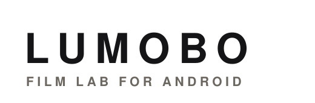
  </picture>
</p>

<p align="center">
  <b>Film simulations, classic camera looks and lens effects for Android.</b><br>
  66 looks · 10 lens recipes · grain, halation &amp; bloom · full-resolution export
</p>

<p align="center">
  <a href="https://github.com/amarsakore/lumobo/releases/latest"></a>
  
  
  
  <a href="LICENSE"></a>
</p>

<table>
  <tr>
    <td width="50%">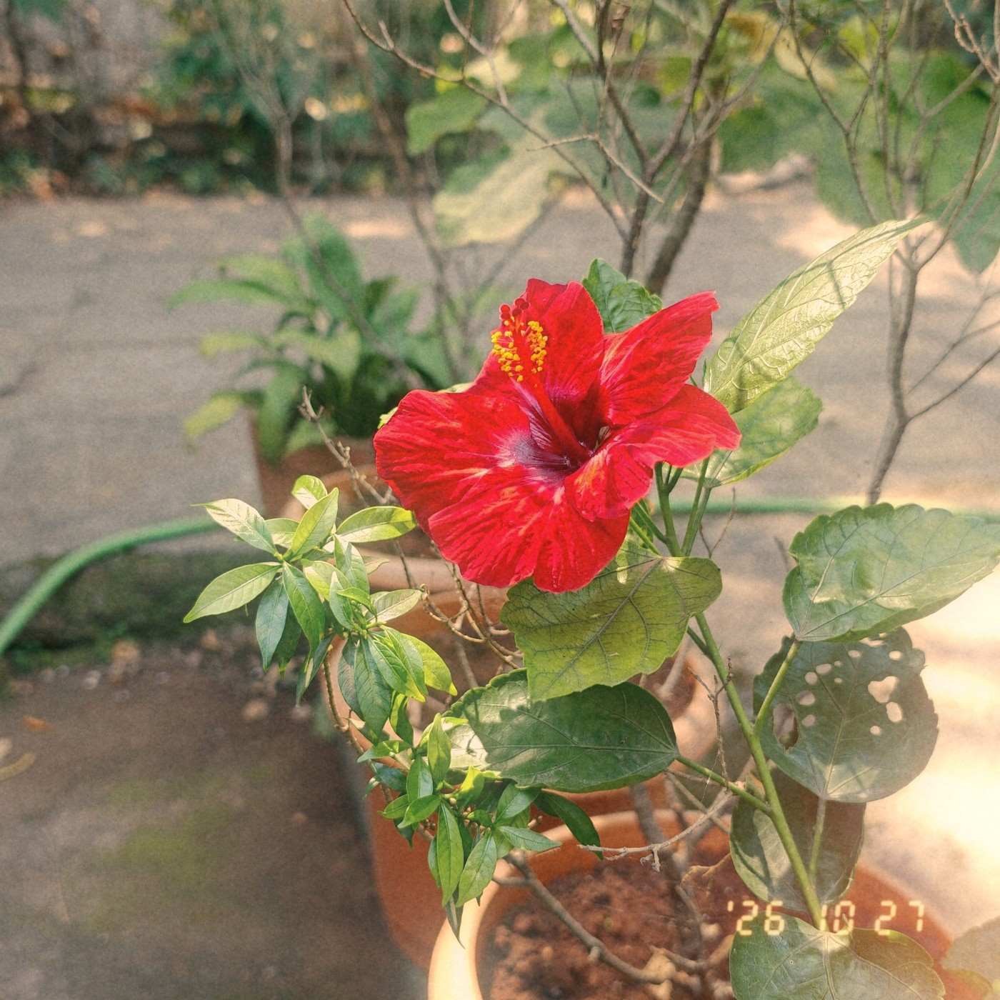</td>
    <td width="50%">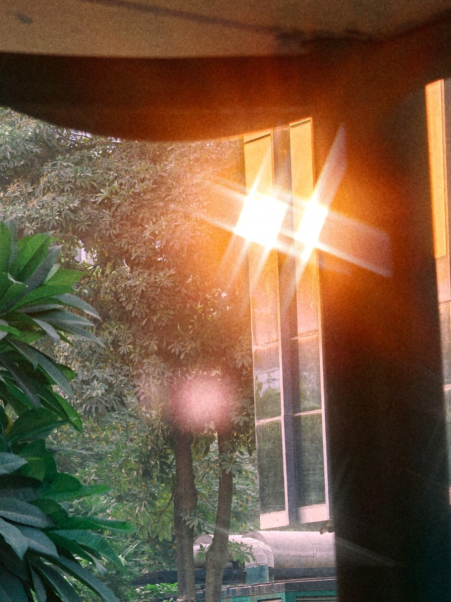</td>
  </tr>
  <tr>
    <td align="center"><sub><b>Daydream</b> · 1:1 crop · red corner leak · LED date stamp</sub></td>
    <td align="center"><sub><b>Rose Film</b> · Twinkle star filter · straightened 4°</sub></td>
  </tr>
  <tr>
    <td>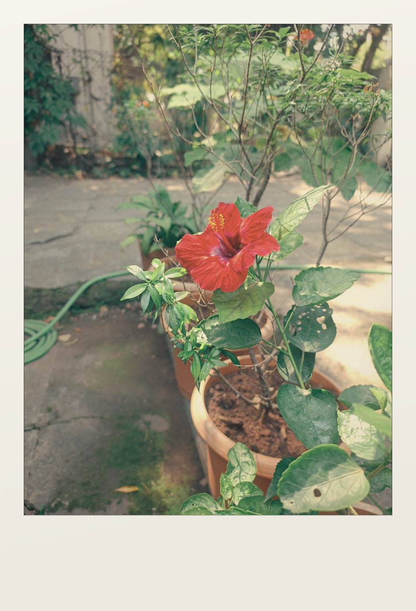</td>
    <td></td>
  </tr>
  <tr>
    <td align="center"><sub><b>Polaroid 600</b> · instant frame · bloom · vignette</sub></td>
    <td align="center"><sub><b>CineStill 800T</b> · red halation · grain</sub></td>
  </tr>
</table>
<p align="center"><sub>Straight out of the app, developed at full resolution on the phone.</sub></p>

## Features

- **88 looks in 10 families.** Moody **Vibes** recipes (Daydream, Basement Tape, Summer '99, Night Drive…), Fujifilm simulations (Provia, Velvia, Classic Chrome, Classic Neg, Nostalgic Neg, Acros…), Ricoh GR image controls, iPhone-style filters (Vivid, Dramatic, Mono, Silvertone, Noir…), Kodak and Fuji film stocks, cinema stocks, instant film, Ilford B&amp;W, and camera styles such as disposable, Y2K CCD digicam, Leica M, Hasselblad, Contax T2 and Lomo LC-A.
- **Film texture on every photo.** Each look gets grain, halation and bloom in its own flavour. Overall strength is set in Settings.
- **Lens recipes.** Fisheye, circular fisheye, wide-angle, star filters that make water and lights twinkle, anamorphic streaks, tilt-shift, soft focus and Petzval-style swirl. Each recipe can be fine-tuned.
- **Film and optical effects.** Clumped, luminance-weighted grain with dye-cloud colour, red halation, Pro-Mist bloom, vignette, chromatic aberration and four light-leak styles.
- **Pro editing tools.** Light (with histogram and Auto), Color, HSL Mixer, Color Grading wheels, point Curves and Detail (Texture, Clarity, Sharpen, Dehaze, HDR, Glow), with edge-aware detail that never draws halos. Save any combination as one of *My Looks*.
- **Crop and straighten.** Aspect presets (Original, Free, 1:1, 4:5, 3:4, 2:3, 9:16, 16:9, XPan…), a Lightroom-style straighten dial, vertical and horizontal perspective, flips and 90° rotation. Pinch to zoom into the crop and drag it with two fingers.
- **Compact editor.** A Lightroom-style bottom bar with a pull-up panel for tools with many sliders, soft haptic ticks on sliders, and one-tap Reset all.
- **Undo and redo** for every change. A whole slider drag counts as one step.
- **Re-edit any time.** Every developed photo stores its full recipe: original photo, look, sliders, effects, lens and crop. *Edit Again* picks up exactly where you left off.
- **Frames and imprints.** Instant border, white border or a 35mm film scan with sprocket holes, plus a seven-segment LED date stamp in your choice of colour and format.
- **Built-in gallery and viewer.** Browse by month and album, pinch to change the grid size, open photos from Google Photos, keep developed shots in their own tab, and pinch to zoom.
- **Useful settings.** Film-texture strength, start with your last look, date stamp defaults, default frame, JPEG quality, export size, keep or strip location and camera data, grid size, screenshots filter and haptics.
- **Fast, private and offline.** About 20–40&nbsp;ms per preview on a modern phone, and the same GPU pipeline renders the full-resolution export. Nothing is uploaded.

## Before / after

<table>
  <tr>
    <td>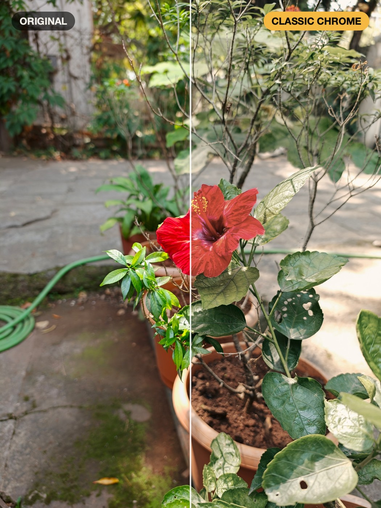</td>
    <td></td>
    <td></td>
  </tr>
  <tr>
    <td align="center"><sub>Classic Chrome</sub></td>
    <td align="center"><sub>Velvia</sub></td>
    <td align="center"><sub>GR Negative Film</sub></td>
  </tr>
</table>

## The app

<p align="center">
  
  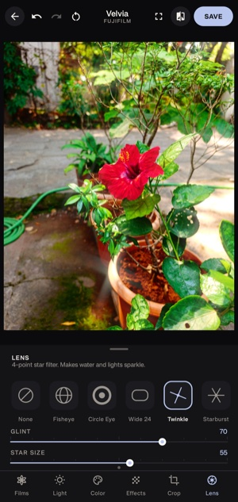
  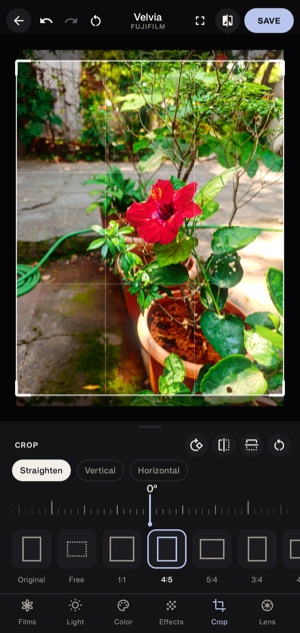
  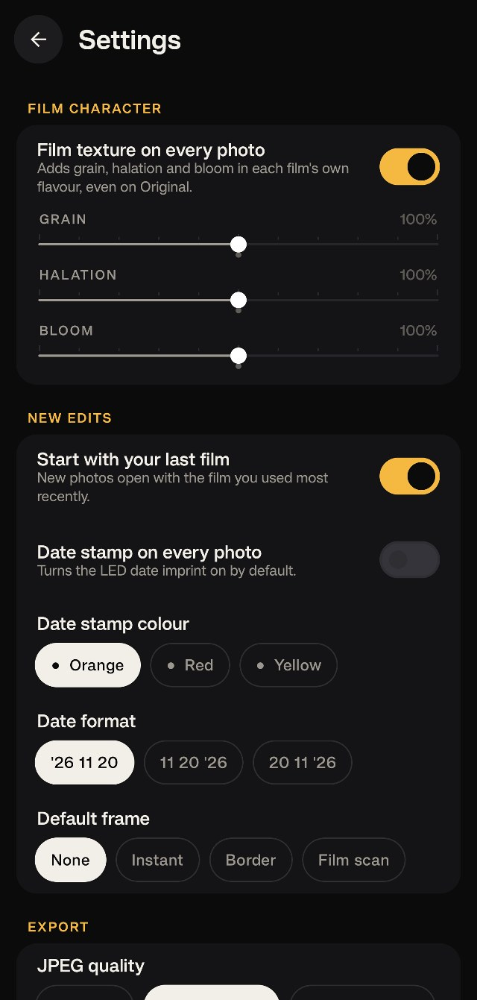
</p>

## Install

Download `Lumobo.apk` from the [latest release](https://github.com/amarsakore/lumobo/releases/latest) and open it on your phone (allow installs from your browser or file manager when asked). Requires Android 10 or newer with OpenGL ES 3.0.

Or with a phone connected over USB debugging:

```bash
adb install -r Lumobo.apk
```

## Lens recipes

| Recipe | What it does |
|---|---|
| **Fisheye** | Ultra-wide fisheye bulge, full frame. |
| **Circle Eye** | Circular fisheye with a black surround. |
| **Wide 24** | Gentle wide-angle barrel distortion. |
| **Twinkle** | 4-point star filter. Makes water and lights sparkle. |
| **Starburst** | 6-point star filter for sun and street lights. |
| **Sparkle** | Short 8-point glints on every highlight. |
| **Anamorphic** | Cinematic horizontal blue streaks from lights. |
| **Tilt-Shift** | Miniature look with a sharp focus band. |
| **Soft Focus** | Dreamy diffusion, like a vintage portrait lens. |
| **Swirl** | Petzval-style swirling, soft edges. |

## The look library

The grids below show colour only, so you can compare the looks directly. Grain, halation, lens effects and frames are added on top in the app.

### Vibes: moody analog recipes


| Look | Code | Character |
|---|---|---|
| **Daydream** | `DRM` | Soft pastel warmth, glowing highlights and a stray red leak. |
| **Basement Tape** | `BT` | Late-night snapshot. Teal shadows, amber glow, heavy corners. |
| **Summer '99** | `S99` | Point-and-shoot holiday prints. Sunny, saturated, date-stamped. |
| **Night Drive** | `ND` | Neon-soaked and cinematic. Cyan night, glowing red halos. |
| **Golden Hour** | `GH` | Late sun forever. Honeyed highlights and a warm haze. |
| **Blue Hour** | `BH` | Cool, quiet and a little melancholic. |
| **Faded Memory** | `FM` | A print left in the sun. Washed, creamy and nostalgic. |
| **Rose Film** | `RF` | Experimental stock with rosy highlights and cool shadows. |
| **Noir** | `NOIR` | Hard-boiled black & white with glowing highlights. |

### Fujifilm film simulations


| Look | Code | Character |
|---|---|---|
| **Provia** | `STD` | Standard. Faithful colour with a gentle slide-film punch. |
| **Velvia** | `V` | Vivid. Saturated landscape slide film with deep blacks and rich skies. |
| **Astia** | `S` | Soft. Gentle tonality for skin, while keeping skies vivid. |
| **Classic Chrome** | `CC` | Documentary slide look. Muted colour, hard shadows, deep teal skies. |
| **Classic Neg** | `NC` | Superia-inspired. Hard contrast, teal shadows, warm highlights, magenta reds. |
| **Nostalgic Neg** | `NN` | 70s American colour. Amber highlights, soft roll-off, rich shadows. |
| **Reala Ace** | `RA` | Faithful colour with a crisp, hard tonality. |
| **Pro Neg Hi** | `NH` | Portrait negative with a little extra contrast. |
| **Pro Neg Std** | `NS` | Soft studio negative. Low contrast, natural, flattering skin. |
| **Eterna** | `ET` | Motion-picture stock. Flat, low saturation, teal shadows. |
| **Eterna Bleach** | `EB` | Skipped-bleach cinema process. Silver-retained, harsh and desaturated. |
| **Acros** | `A` | Fine-grain black & white with rich, deep tonality. |
| **Acros + R** | `A+R` | Acros through a red filter. Dark dramatic skies, bright skin. |
| **Acros + Ye** | `A+Y` | Acros through a yellow filter. Gently deepened skies. |
| **Acros + G** | `A+G` | Acros through a green filter. Smooth skin, lighter foliage. |
| **Sepia** | `SEP` | Warm brown-toned monochrome. |

### Ricoh GR image controls

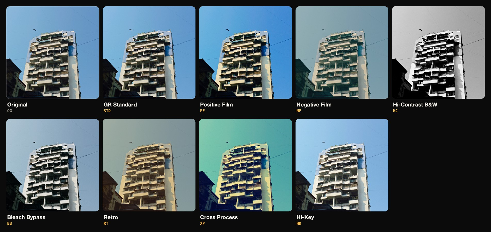

| Look | Code | Character |
|---|---|---|
| **GR Standard** | `STD` | The GR's clean, crisp default rendering. |
| **Positive Film** | `PF` | Slide film punch. Warm, saturated, contrasty with yellow-tinted highlights. |
| **Negative Film** | `NF` | Low-contrast print look. Faded cyan blacks, muted colour. |
| **Hi-Contrast B&W** | `HC` | The GR street classic. Gritty, crushed and graphic. |
| **Bleach Bypass** | `BB` | Desaturated, metallic and contrasty. |
| **Retro** | `RT` | Faded and warm, like an old print in a shoebox. |
| **Cross Process** | `XP` | Slide film in negative chemistry. Yellow-green highs, blue shadows. |
| **Hi-Key** | `HK` | Bright, airy and soft. |

### Kodak


| Look | Code | Character |
|---|---|---|
| **Portra 400** | `P400` | The portrait standard. Warm skin, soft contrast, pastel greens. |
| **Portra 160** | `P160` | Finer and cooler than 400. Clean pastel daylight. |
| **Portra 800** | `P800` | Pushed portrait stock. Warmer, richer and grainier. |
| **Ektar 100** | `E100` | The world's finest-grain colour negative. Ultra-saturated and punchy. |
| **Gold 200** | `G200` | Golden-hour in a box. Warm yellows and nostalgic sunshine. |
| **ColorPlus 200** | `CP` | Budget everyday film. Warm, slightly soft, honest. |
| **UltraMax 400** | `UM` | Consumer all-rounder. Saturated reds and warm daylight. |
| **Kodachrome 64** | `KR` | The legendary slide film. Deep reds, dense blacks, timeless warmth. |
| **Ektachrome E100** | `E6` | Modern slide film. Clean, cool and vivid blues. |
| **Tri-X 400** | `TX` | The photojournalist's B&W. Punchy contrast, honest grain. |
| **T-Max 100** | `TMX` | Tabular-grain B&W. Smooth, sharp and modern. |

### Fuji film stocks


| Look | Code | Character |
|---|---|---|
| **Superia 400** | `S400` | Fuji's consumer classic. Cool greens and that tell-tale cyan shadow. |
| **Pro 400H** | `400H` | Wedding-photographer favourite. Airy, minty greens, soft pastel skin. |
| **Fujicolor C200** | `C200` | Cheap and cheerful. Slightly green, a little grainy, very lovable. |

### Cinema

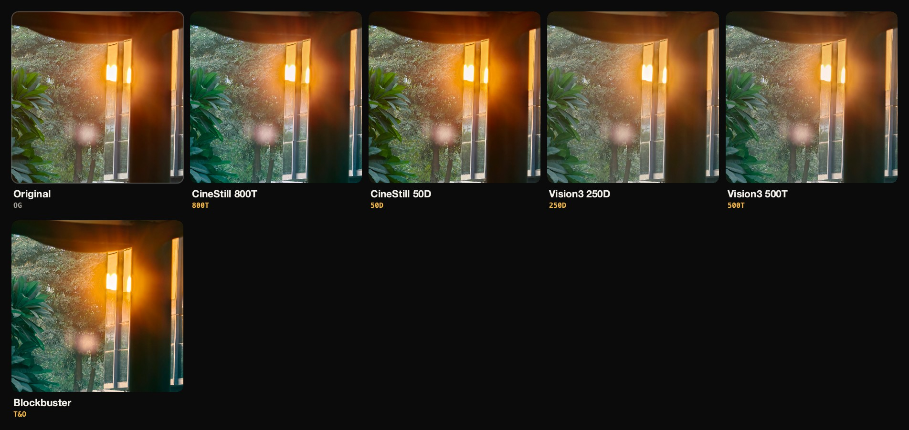

| Look | Code | Character |
|---|---|---|
| **CineStill 800T** | `800T` | Tungsten cine film without remjet. Cool cast and glowing red halation. |
| **CineStill 50D** | `50D` | Daylight cine stock. Clean, crisp and saturated with a soft glow. |
| **Vision3 250D** | `250D` | Hollywood daylight negative. Wide latitude, natural skin, gentle teal. |
| **Vision3 500T** | `500T` | Night-time cine negative. Cool shadows, warm practical lights. |
| **Blockbuster** | `T&O` | Teal and orange colour grade. Big, warm skin against cool shadows. |

### Instant


| Look | Code | Character |
|---|---|---|
| **Polaroid 600** | `600` | Instant integral film. Creamy whites, inky blue-black, dreamy colour. |
| **SX-70** | `SX` | Vintage instant. Warm, washed-out and soft-focus. |
| **Instax Mini** | `MINI` | Bright, poppy party instant with cool shadows. |

### Camera styles


| Look | Code | Character |
|---|---|---|
| **Disposable** | `QS` | Single-use flash camera. Warm, grainy, vignetted, date-stamped. |
| **CCD Digicam** | `CCD` | Y2K compact digital. Cool, punchy, bright highlights with a CCD glow. |
| **Leica M** | `M` | Rangefinder rendering. Dense blacks, warm mids, restrained greens. |
| **Hasselblad** | `HNCS` | Natural colour solution. Smooth gradation and true-to-life skin. |
| **Contax T2** | `T2` | Premium point-and-shoot on colour neg. Warm, sharp, contrasty. |
| **Lomo LC-A** | `LCA` | Shoot from the hip. Saturated, contrasty, heavy vignette. |
| **Toy Camera** | `TOY` | Plastic lens, leaky body. Dreamy glow, soft corners, light leaks. |

### Ilford black & white

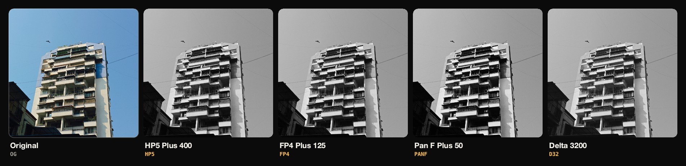

| Look | Code | Character |
|---|---|---|
| **HP5 Plus 400** | `HP5` | Versatile, forgiving B&W with classic medium grain. |
| **FP4 Plus 125** | `FP4` | Fine-grain, medium-contrast B&W with lovely mid-tones. |
| **Pan F Plus 50** | `PANF` | Slow, razor-fine B&W. Deep blacks and luminous highlights. |
| **Delta 3200** | `D32` | Ultra-fast B&W. Bold, gritty grain for low light. |

## How it works

Each look is a small, readable recipe in [`Profiles.kt`](film/src/main/kotlin/app/lumobo/film/Profiles.kt) evaluated by a film model in [`Look.kt`](film/src/main/kotlin/app/lumobo/film/Look.kt):

1. **Exposure and white balance** in linear light, with a soft film shoulder instead of hard clipping.
2. **Tone curve**: a display-referred S-curve that blends a per-channel response (film's saturation and colour crossover) with a luminance-preserving one (stable hues).
3. **Colour** in OKLCh: global and tone-dependent saturation, plus hue bands that shift, saturate or darken specific colours.
4. **Colour casts** in shadows, mids and highlights, mostly on near-neutral tones so saturated subjects keep their identity.
5. **Gamut mapping** that reduces chroma at constant lightness and hue, then **print levels** for faded blacks or creamy whites.

The model is baked into a **64³ 3D LUT**. An OpenGL ES 3 shader ([`Shaders.kt`](app/src/main/java/app/lumobo/render/Shaders.kt)) applies it together with the user adjustments, crop and straighten, lens projection and the optical passes:

- **Halation and bloom** blur thresholded highlights at a fixed working resolution, so the preview and the export glow identically.
- **Star filters and anamorphic streaks** first isolate *glints* (highlights brighter than their surroundings), then draw energy-normalised rays along each arm. Sparkles on water twinkle, while big bright areas don't smear.
- **Tilt-shift, soft focus and swirl** blend in a graded, blurred layer. **Fisheye** uses a true tangent projection, and the circular version maps the whole frame into the circle.
- **Grain** comes from a tileable, gaussian-clumped noise field sized to the frame.

Every developed JPEG carries its edit recipe in EXIF, which is what makes *Edit Again* non-destructive.

Here is a complete look:

```kotlin
FilmProfile(
    "vibe_daydream", "Daydream", "DRM", Category.VIBES,
    "Soft pastel warmth, glowing highlights and a stray red leak.",
    Look(
        temp = 0.06f,
        curve = Curve(contrast = 0.92f, shadows = 0.10f, highlights = -0.12f, whites = -0.15f),
        rgbCurveMix = 0.5f, saturation = 0.96f,
        bands = listOf(
            Band(Hue.SKIN, 30f, shift = 2f, sat = 0.98f, light = 0.02f),
            Band(Hue.FOLIAGE, 40f, shift = -4f, sat = 0.85f),
            Band(Hue.SKY, 50f, shift = -6f, sat = 0.92f),
        ),
        shadowTone = Tone(205f, 0.016f), highlightTone = Tone(70f, 0.030f),
        black = Rgb(0.045f, 0.04f, 0.04f), white = Rgb(1f, 0.98f, 0.95f),
    ),
    Effects(grain = 0.24f, grainSize = 0.4f, halation = 0.18f, bloom = 0.38f, leak = 0.42f, leakStyle = 1, dateStamp = true),
),
```

## Build from source

Requirements: JDK 17 and the Android SDK (platform 35).

```bash
./gradlew :app:assembleRelease     # app/build/outputs/apk/release/app-release.apk
./gradlew :film:test               # colour-engine tests
```

The colour engine is a plain Kotlin/JVM module, so you can tune looks on your computer:

```bash
# Render every look onto your own photos, 6 per sheet
./gradlew :film:test --tests '*ContactSheetTest*' \
  -Dcontact.in=/path/to/photos -Dcontact.out=/tmp/sheets -Dcontact.chunk=6

# Regenerate the README example images
./gradlew :film:test --tests '*ReadmeAssetsTest*' \
  -Dassets.in=/path/to/sources -Dassets.out=$PWD/docs/examples
```

## Project structure

```
film/                      Pure Kotlin colour science (no Android dependencies)
  ColorMath.kt             sRGB transfer, OKLab/OKLCh, fast lookup tables
  Look.kt                  Curve, Look and CompiledLook (film model and LUT baking)
  Profiles.kt              Every look, lens recipes, film-texture flavours, geometry
  Adjustments.kt           User adjustments, LUT cache, grain field generator
app/
  render/GlRenderer.kt     EGL off-screen renderer: LUT, glow / star / blur passes, export
  render/Shaders.kt        GLSL: film pipeline, lens projection, optics, grain
  render/Overlays.kt       LED date stamp and frames
  render/Images.kt         Decoding (EXIF-aware, sRGB) and saving with recipe + metadata
  editor/                  Editor state, undo/redo, recipes, re-edit resolution
  ui/                      Compose screens: gallery, editor, viewer, settings
docs/                      Logo, examples, screenshots
```

## Disclaimer

Fujifilm, Provia, Velvia, Astia, Acros, Eterna, Superia, Ricoh, GR, Kodak, Portra, Ektar, Kodachrome, Ektachrome, Tri-X, T-Max, CineStill, Polaroid, Instax, Ilford, Leica, Hasselblad, Contax and Lomo are trademarks of their respective owners. Lumobo is an independent project and is not affiliated with or endorsed by any of them. The looks are original recreations of each film's or camera's well-known character. They contain no proprietary data.

## License

[MIT](LICENSE) © 2026 amarsakore
